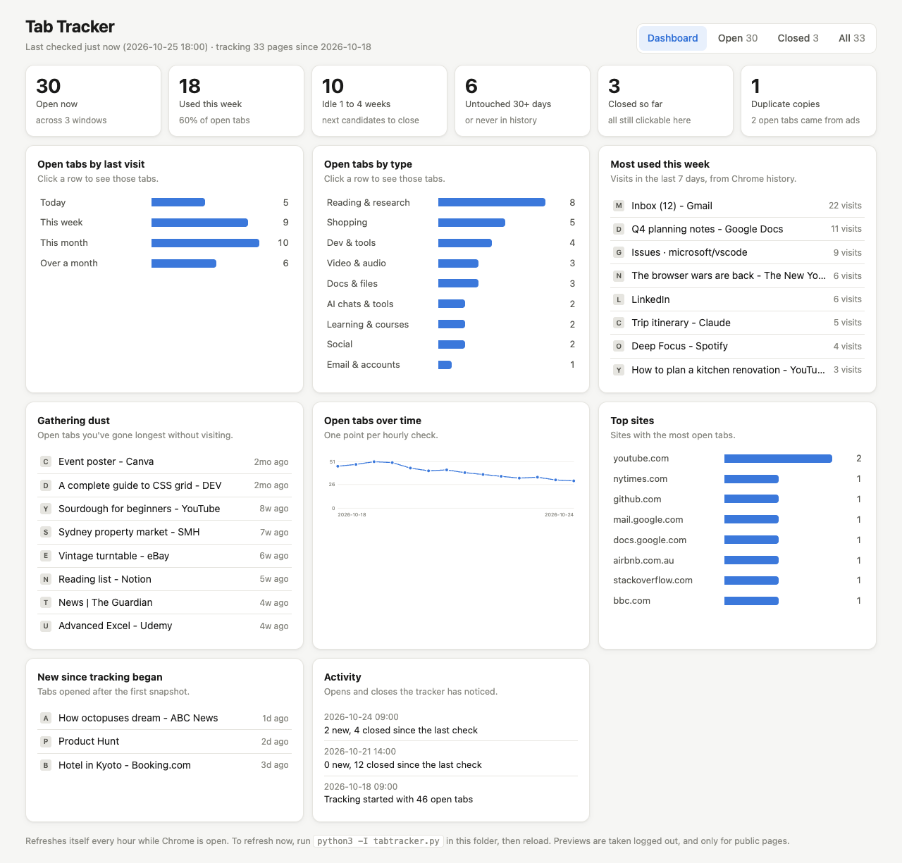
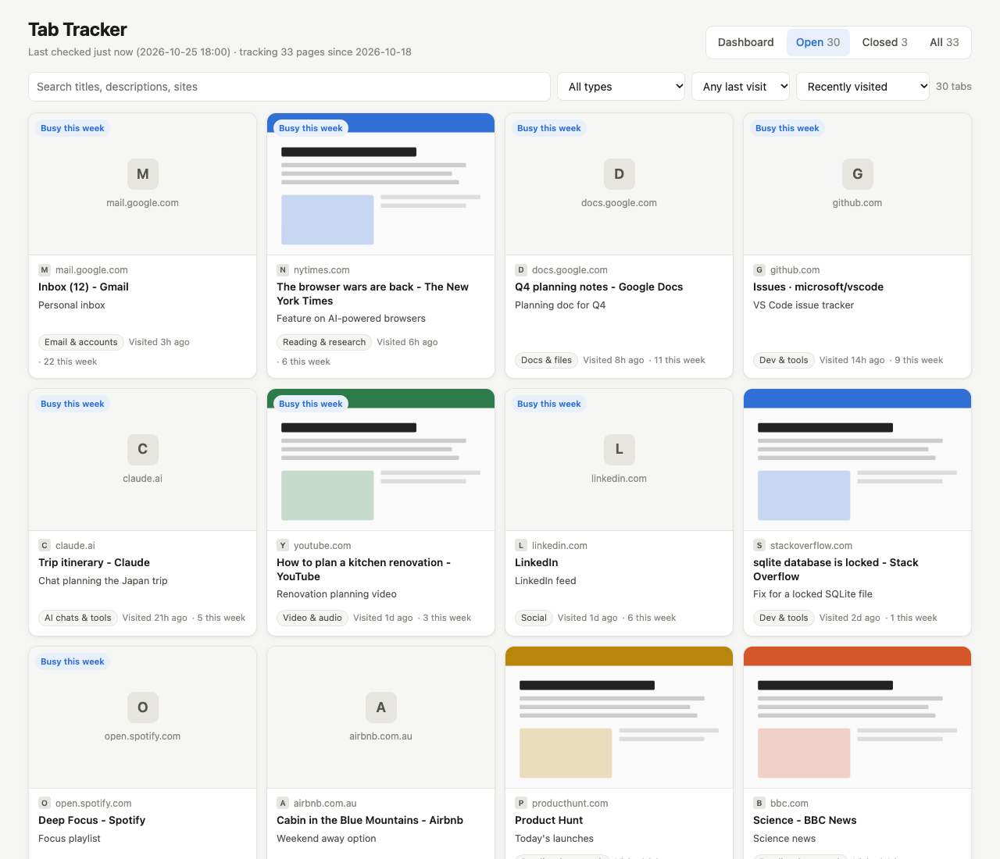

# Tab Tracker

I had over 130 Chrome tabs open and no idea which ones I still needed. Closing them felt risky, so I built this instead.

Tab Tracker keeps a record of every tab you open in Chrome, works out which ones you actually use, and shows it all on a dashboard. Once everything is on record, closing tabs stops being scary: anything you close is still one click away.



## What it does

- **Dashboard.** How many tabs are open, how many you've used this week, how many have sat untouched for a month, duplicates, and tabs that came from ads. Charts by last visit and by type, your most used tabs this week, the ones gathering dust, and your open tab count over time.
- **Every tab as a card.** A preview of the page, the site icon, a short description, when you last visited and how often. Click a card to open the page.
- **History.** Tabs you close stay in the record with the date you closed them. Search, filter and sort across open, closed or everything.
- **Updates itself.** A small background job checks Chrome every hour. If Chrome isn't open, it skips that hour.



## Privacy

Everything stays on your Mac. Nothing is uploaded anywhere.

- It reads your open tabs from Chrome, and reads a copy of Chrome's history and favicon files to work out when you last visited each page. It never opens, closes or changes a tab.
- Page previews are taken in a separate, logged-out headless Chrome, so they never see your accounts. Pages that are private or risky to load are skipped and get the site icon instead: email, Google Docs and Drive, Notion, AI chats, social media, payments, logins, checkouts, account pages, and any link with an email address, phone number or token in it.
- Your data lives in this folder as `db.json`, `data.js`, `thumbs/` and `favicons/`. The `.gitignore` keeps them out of git, so you won't commit your browsing by accident.

## Requirements

- macOS
- Google Chrome, installed in `/Applications`
- Python 3. It comes with the Xcode Command Line Tools: run `xcode-select --install` if `python3` isn't found.

## Install

1. Download or clone this repo into your home folder, for example `~/TabTracker`.
   Not Documents, Desktop or Downloads: macOS blocks background jobs from those folders, and the hourly refresh would fail.
2. In Terminal, run:
   ```bash
   cd ~/TabTracker
   ./install.sh
   ```
3. macOS will ask whether **python3** may control **Google Chrome**. Click **Allow**.
   Missed it? Go to System Settings, Privacy & Security, Automation, and switch on Google Chrome under python3.
4. Open `index.html` in Chrome and bookmark it.

The first run takes a few minutes while it builds page previews. After that each hourly check takes seconds.

## Use

- Reload the page to see the latest data.
- To refresh straight away: `python3 -I tabtracker.py` in this folder. Add `--no-thumbs` to skip previews.
- The log of each run is in `tabtracker.log`.

## Make it yours

- **Tab types.** Tabs are sorted into types by matching words in the link and title. Edit `CATEGORIES` at the top of `tabtracker.py` to add your own, for example your clients' domains.
- **Previews.** Add a site to `SKIP_HOSTS` to never take a preview of it.
- **Descriptions.** New tabs get the page's own summary when a preview can be taken. You can write your own straight into the `desc` field in `db.json`.

## Uninstall

```bash
./uninstall.sh
```

That stops the hourly refresh. Your tab history stays in the folder until you delete it.

## Known limits

- Chrome doesn't record when you last clicked on a tab, so "last visited" is the last time the page was loaded, from your history. A tab you glance at without reloading will look older than it is.
- Duplicate tabs are grouped by exact URL.
- Chrome only, macOS only.

## Licence

MIT. Use it, change it, share it. See [LICENSE](LICENSE).
